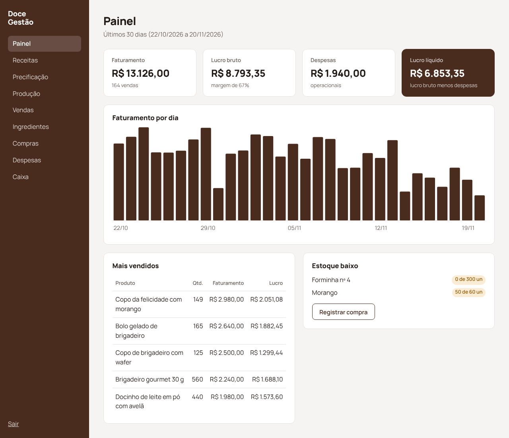
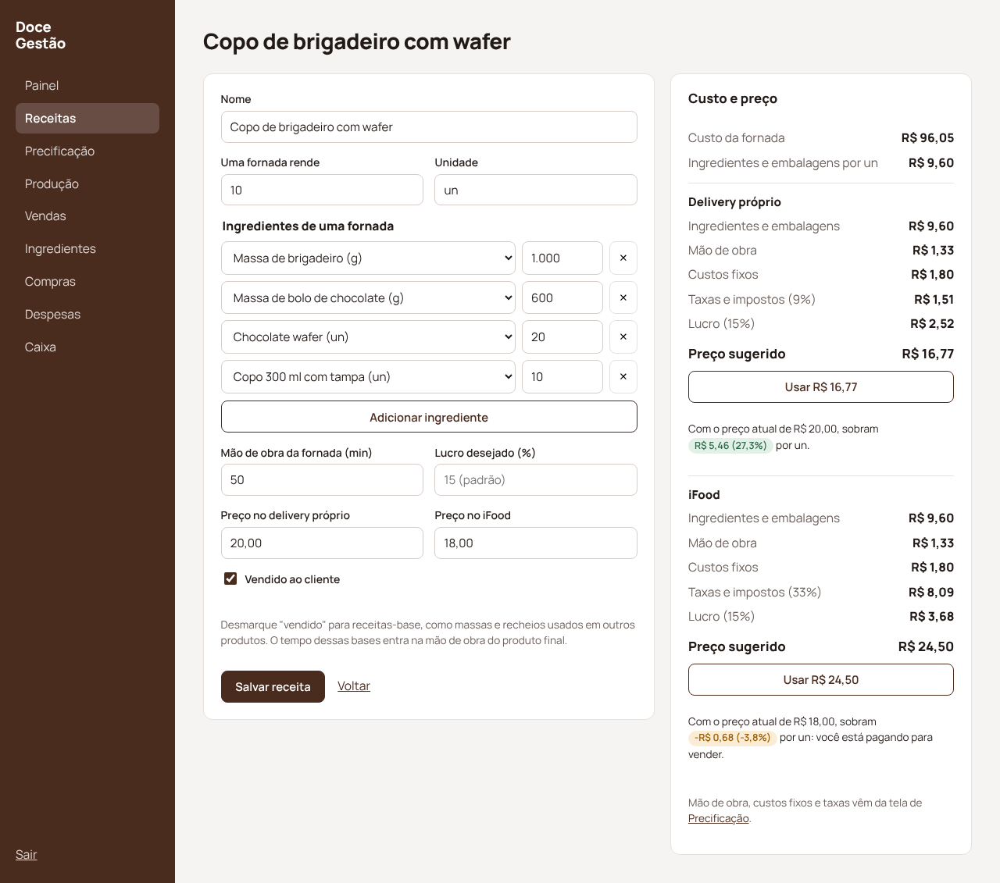
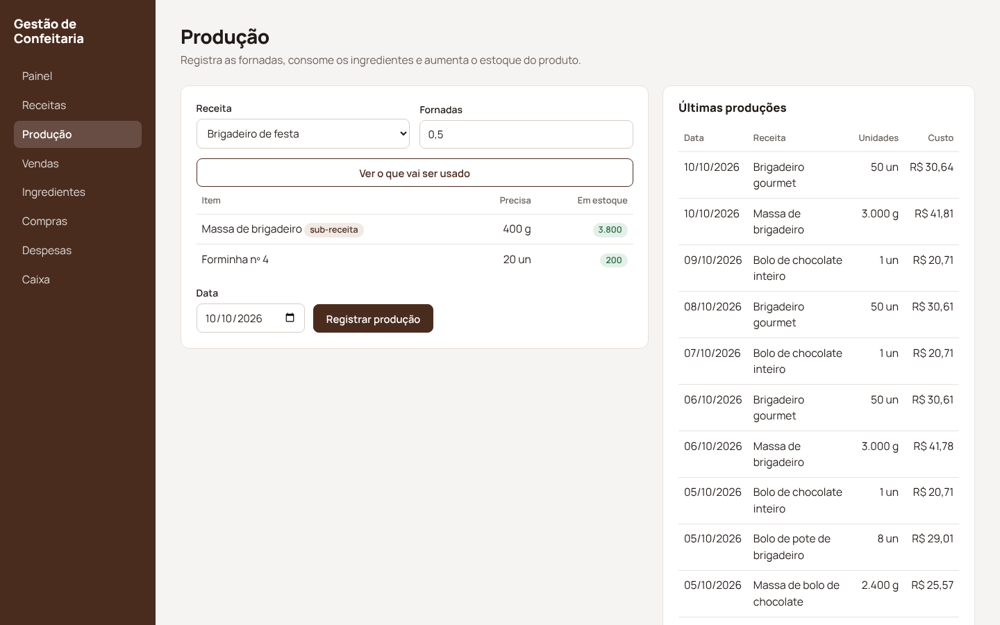
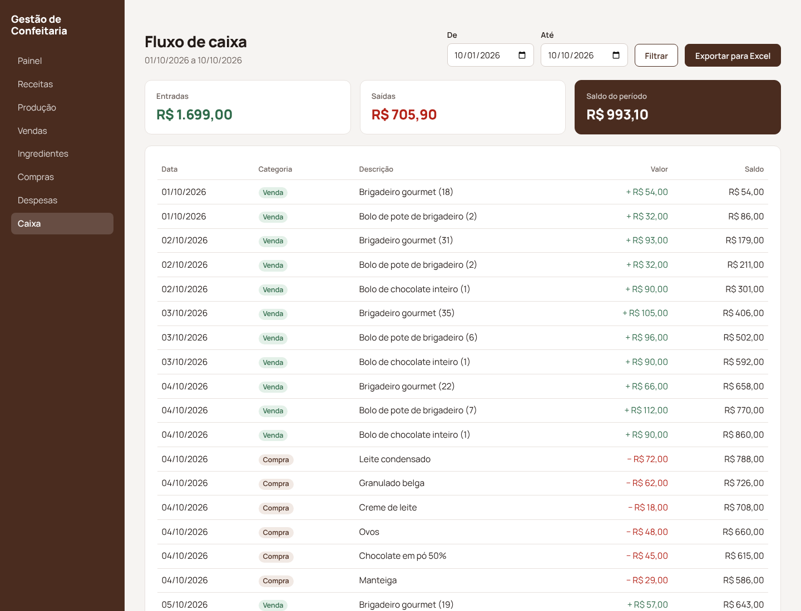

# Doce Gestão

[](https://github.com/wagnerglongo/doce-gestao/actions/workflows/ci.yml)

Precificação e gestão para confeitarias e docerias: **ficha técnica com custo real de cada doce**, preço sugerido por canal de venda (delivery próprio e iFood) com mão de obra, custos fixos, taxas e impostos, controle de produção e estoque, vendas, despesas e fluxo de caixa com exportação para Excel.

Feito em **PHP 8 puro** (sem framework), com as regras de negócio isoladas em classes de domínio e cobertas por testes.

<p align="center"></p>

## O problema que ele resolve

Quem vende doce costuma precificar "de cabeça" e não sabe quanto lucra de verdade. O sistema responde três perguntas:

1. **Quanto custa cada unidade?** Pela receita, usando o custo médio de cada ingrediente nas compras.
2. **Por quanto vender?** O preço sugerido soma ingredientes, embalagem, mão de obra, custos fixos a taxa de cada canal (delivery próprio e iFood) e os impostos sobre a venda, e garante o lucro desejado.
3. **Quanto sobrou no fim do mês?** Pelo faturamento, menos o custo do que foi vendido e as despesas.

<p align="center"></p>

## Funcionalidades

- **Precificação completa por canal:** valor da hora de trabalho, custos fixos como % do faturamento (markup: cada produto paga fixo proporcional ao preço), taxa do delivery próprio, comissão do iFood e impostos sobre a venda. Cada produto mostra a composição do preço, o preço sugerido em cada canal e quanto sobra de verdade com o preço atual (e avisa quando está dando prejuízo).
- **Itens de revenda:** refrigerante, água e outros produtos comprados prontos entram como produto de um item só, com custo, preço e estoque.
- **Receitas com sub-receitas:** o bolo de pote usa a *massa de bolo* e a *massa de brigadeiro*, que também são receitas. O custo é calculado em cascata.
- **Proteção contra receita circular:** se a massa usar o bolo, que usa a massa, o sistema avisa e não salva.
- **Custo médio ponderado:** cada compra recalcula o custo do ingrediente considerando o que já tinha em estoque.
- **Produção em fornadas:** mostra antes o que vai ser consumido e o que falta, e só registra se tiver tudo.
- **Vendas guardam o custo do momento:** o lucro de cada venda continua correto mesmo que o preço dos ingredientes mude depois.
- **Usuários:** tela para criar, editar (nome, e-mail, senha) e excluir quem pode entrar.
- **Painel:** faturamento, lucro bruto, margem, lucro líquido, gráfico diário, mais vendidos e alerta de estoque baixo.
- **Fluxo de caixa** por período, com saldo acumulado e **exportação em CSV** que abre certo no Excel em português.

<p align="center"> </p>

## Decisões técnicas

| Tema | O que foi feito |
|---|---|
| Regras de negócio | `Pricing` (markup: preço = custo direto ÷ (1 − fixos% − taxa% − impostos% − lucro%), por canal), `RecipeCost` (custo recursivo com memória e detecção de ciclo), `Inventory` (compra, produção e venda) e `Reports` (caixa e indicadores) não dependem de HTML nem de requisição. São testadas direto, com banco SQLite em memória. |
| Consistência | Compra, produção e venda rodam em **transação**. A produção confere o estoque de tudo antes de mexer em qualquer coisa: nunca fica pela metade. |
| Dinheiro | Valores em **centavos inteiros**. Custos unitários (frações de centavo por grama) só são arredondados na hora de exibir ou gravar uma venda. |
| Segurança | Login com `password_hash` e limite de tentativas, token CSRF em todo POST, consultas preparadas, escape de HTML em tudo que vem do banco e *Content-Security-Policy* sem scripts inline. |
| Excel | CSV com `;`, vírgula decimal e BOM UTF-8. Textos que começam com `=`, `+`, `-` ou `@` são neutralizados para não virarem fórmula (*CSV injection*). |
| Banco | Mesmo código com SQLite (desenvolvimento) e MySQL (produção na Hostinger). |

## Publicando na Hostinger (Web Premium)

Não precisa de Docker nem de Composer no servidor: o sistema é PHP puro e carrega as próprias classes.

1. **Banco:** no hPanel, *Bancos de dados › MySQL*, crie o banco e o usuário.
2. **Site:** crie o subdomínio e, em *Avançado › Git*, conecte este repositório (branch `main`) na pasta do subdomínio. Cada push no `main` publica sozinho.
3. **Configuração:** no *Gerenciador de arquivos*, copie `config.example.php` para `config.php` na mesma pasta e preencha os dados do banco. O `config.php` não vai para o Git.
4. **Instalação (uma vez):** pelo SSH (hPanel › *Avançado › Acesso SSH*), dentro da pasta do site:

```bash
php bin/setup.php                  # demonstração, com 30 dias de exemplo (usuário e senha do config.php)
php bin/setup.php --sem-exemplo    # cliente: começa vazio
```

O `.htaccess` da raiz serve tudo de dentro de `public/`: `src/`, `templates/`, `bin/` e o `config.php` nunca ficam acessíveis pelo navegador.

Depois de cada push, o próprio sistema acrescenta as tabelas e colunas novas no primeiro acesso, sem apagar nada. Não precisa rodar o setup de novo.

## Rodando no computador

```bash
ADMIN_EMAIL=voce@exemplo.com ADMIN_PASSWORD=sua-senha php bin/setup.php   # usa SQLite (database.sqlite)
php -S localhost:8000 -t public public/index.php                          # http://localhost:8000
```

## Testes

```bash
composer install && composer test    # 39 testes: custo, precificação por canal, ciclos, estoque, transações, caixa, CSV, login e CSRF
```

O GitHub Actions roda os testes e instala o sistema num MySQL, sem Composer, como na Hostinger, a cada push.

---

Os dados de exemplo são fictícios. Desenvolvido pela [WGL Software](https://wglsoftware.com).
